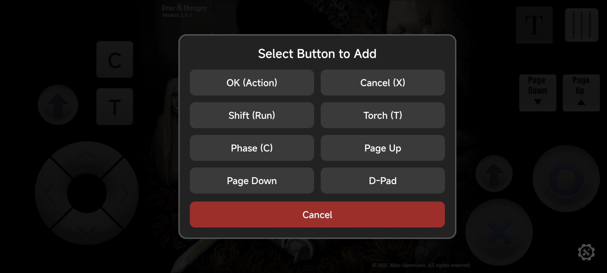
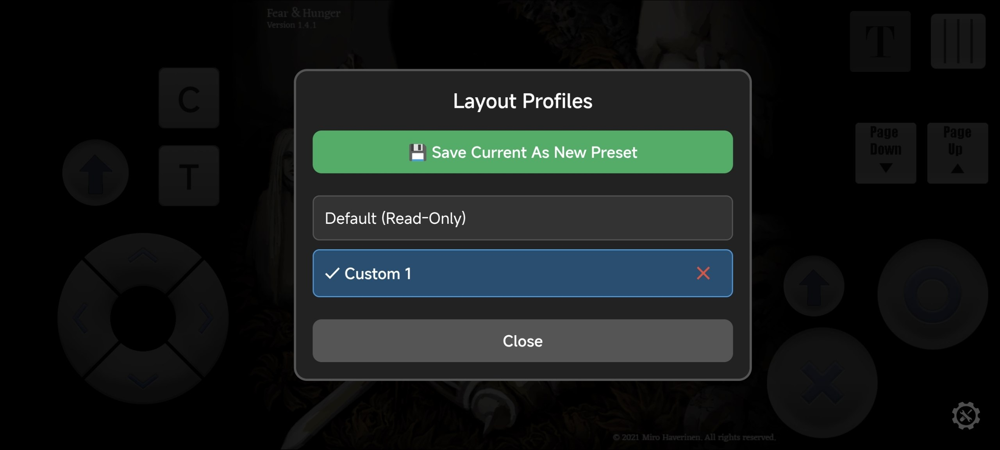
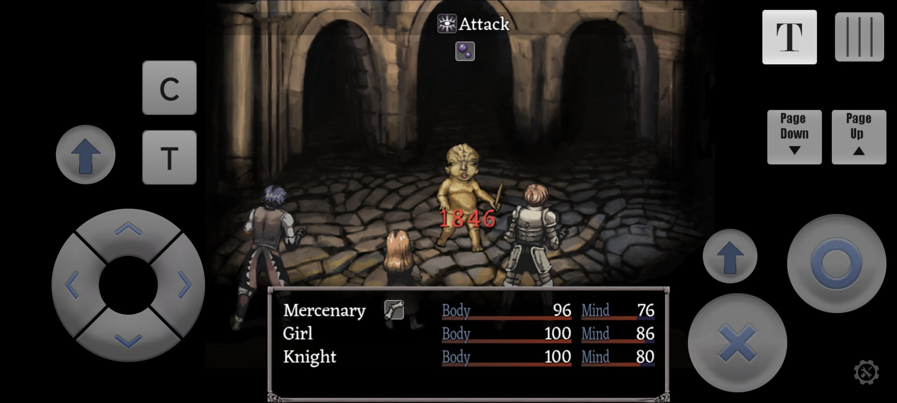
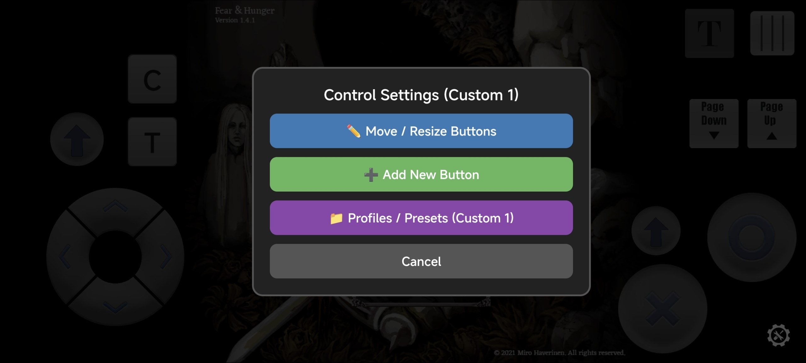
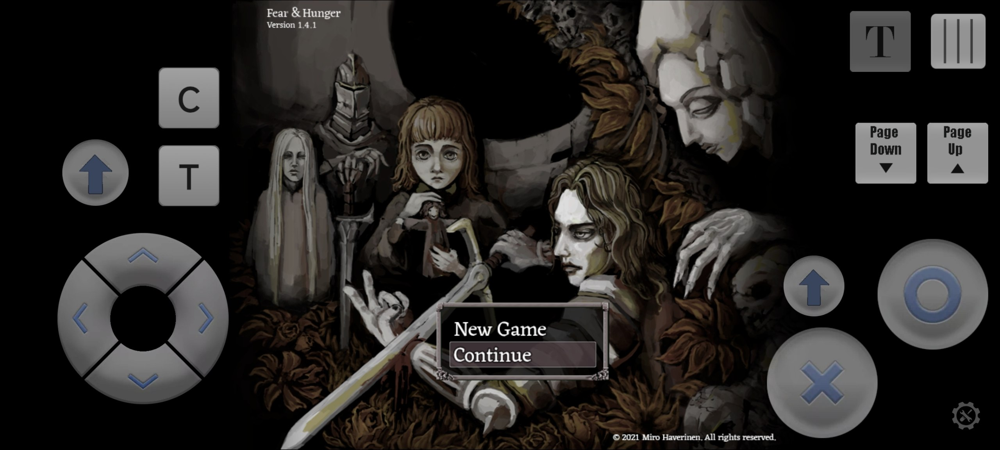

# Fear & Hunger — Android Edition

An optimized, fully stable Android build of *Fear & Hunger*, built to eliminate performance bottlenecks and freeze issues found in existing mobile ports (inspired by [Chokage's Fear-And-Hunger-Android-Application](https://github.com/Chokage/Fear-And-Hunger-Android-Application) project).

## Screenshots

| Touch Buttons | Layout | Critical Hit Performance |
| :---: | :---: | :---: |
|  |  |  |

| Touch Settings & Presets | Main Menu |
| :---: | :---: |
|  |  |

## Key Improvements

- **Critical Hit Performance Fix:** Resolved the severe 500–1000ms Main Thread freeze on critical hits. Replaced CPU-bound Canvas pixel blending (`setBlendColor`) in `rpg_sprites.js` with GPU-accelerated `tint` and `scale` transformations.
- **Modern Android Compatibility:** Cleaned up and updated `index.html` dependencies for smooth execution on modern Android WebView containers (Android 12–14+) without frame drops.
- **Expanded Touch & Controls:** Fully customizable and expanded on-screen touch controller layout for better ergonomics across various screen sizes. All PC default buttons are available!
- **Community Fixes & QoL:** Integrated essential community patches and quality-of-life improvements while keeping core game files and logic completely intact (e.g., [F&H Bug Fixes & QoL](https://www.youtube.com/watch?v=7nkl8lOYhos)).

## Touch Controls & Layout Customization

The game features a fully customizable touch overlay. You can access the touch setup menu by tapping the **Menu button [|||]** located in the top-right corner of the screen.

### Controls Guide

- **Open Settings Menu:** Tap the **Menu button [|||]** to open options for editing buttons, adding new keys, or managing presets.
- **Move Buttons:** Enter edit mode via `✏️ Move / Resize Buttons`. Tap and drag any button to move it across the screen.
- **Resize Buttons:** Select a button in edit mode (highlighted with a blue border) and use a **two-finger pinch gesture** anywhere on the screen to resize it. If a button is too small, simply hold one finger on it and pinch/stretch with another finger elsewhere on the screen.
- **Delete Buttons:** Tap a button in edit mode, then tap the **🗑️ Floating Trash icon** above it to remove it.
- **Add Extra Buttons:** Use `➕ Add New Button` in the menu to place missing keys on your screen (including D-Pad, OK, Cancel, Shift, Torch (T), Phase (C), Page Up, and Page Down).
- **Save & Profiles:** Tap `📁 Profiles / Presets` to save your current layout as a custom preset or switch between created layouts.
- **Fast Forward Toggle:** Tap the **Extra button [T]** to lock fast-forward/skip without holding down Page Down manually. Tap again to disable.

## Downloads

- **`fear_hunger.apk`** — Clean production build optimized for maximum performance.
- **`fear_hunger_eruda.apk`** — Developer build featuring an integrated [Eruda](https://github.com/liriliri/eruda) mobile console for testing and debugging. Very helpful if you're having issues with mods or the client on your device!

## Installation

Simply download and install the preferred APK on your Android device. No additional steps required!

## Support the Creator

This project does not include any copyrighted game assets and is intended strictly for users who already own the game. If you enjoy *Fear & Hunger*, please support the original developer by purchasing it on Steam or itch.io:

* **[Fear & Hunger on Steam](https://store.steampowered.com/app/1002300/Fear_Hunger/)**
- **[itch.io Store Page](https://mirohaver.itch.io/fear-and-hunger)**
